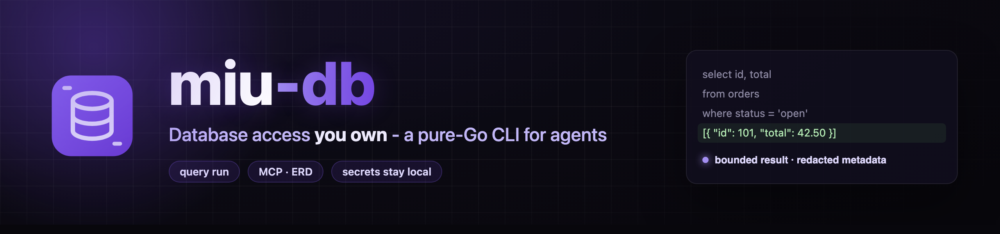

<p align="center"></p>

<p align="center">
  <a href="https://github.com/vanducng/miu-db/releases"></a>
  <a href="https://go.dev"></a>
  <a href="LICENSE"></a>
</p>

# miu-db

A headless database CLI for humans and agents. Saved connections, keyring
secrets, SSH tunnels, bounded queries, schema, ERDs, and MCP for SQLite,
Postgres, MySQL, Snowflake, and BigQuery, with stable JSON on stdout.

**Docs:** [db.miu.sh](https://db.miu.sh) · agents: append `.md` to any docs URL, or read [`llms.txt`](https://db.miu.sh/llms.txt)

## Get started


```sh
curl -fsSL https://db.miu.sh/install.sh | sh
curl -fsSL https://db.miu.sh/skill.md --create-dirs \
  -o ~/.claude/skills/miudb/SKILL.md
```

Then ask your agent:

```text
/miudb set up miudb: list my saved connections, add a SQLite connection for
./app.db if none exists, smoke-test everything, then show me the schema.
```

Or by hand:

```sh
miudb connections add --name app --db-type sqlite --path ./app.db
miudb connections smoke                              # test every saved connection
miudb query run --connection app --sql 'select * from users' -o pretty
miudb schema tree --connection app
miudb mcp serve --transport stdio                    # read-only tools for agent hosts
```

Other installs (Homebrew, Windows, `go install`): [Install](https://db.miu.sh/install/). More commands: [Getting started](https://db.miu.sh/onboarding/).

## Develop

```sh
go build -buildvcs=false -o ./.miu-db/miudb ./cmd/miudb
go test ./...
```

**Agent skill:** [`.agents/skills/miudb/SKILL.md`](.agents/skills/miudb/SKILL.md) (agent-agnostic); `.claude/skills/miudb` is a symlink to it.

## License

MIT. See [LICENSE](LICENSE).
